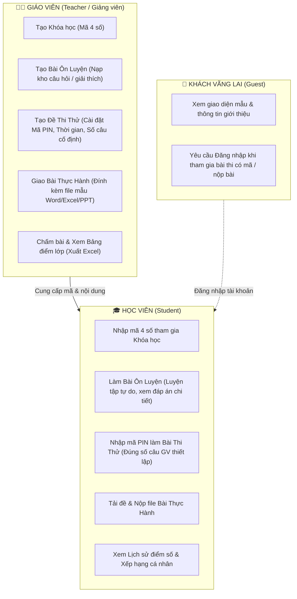
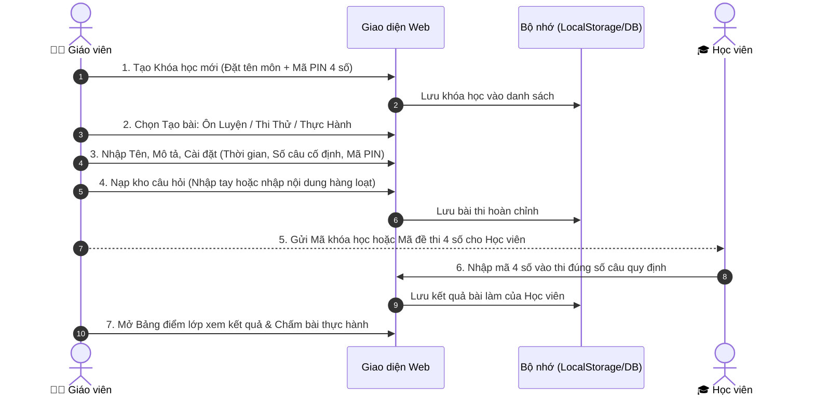

# KẾ HOẠCH TỔNG THỂ: PHÂN HỆ ÔN LUYỆN & THI THỬ THEO PHÂN QUYỀN
> **Dự án:** Hệ thống Đào tạo Tin học Văn phòng (PTPMMNM-Tin-hoc-van-phong)  
> **Trang mục tiêu:** `on-luyen-thi-thu.html`  
> **Mục tiêu:** Chuyển đổi toàn bộ cơ chế từ "đề tạo sẵn cố định" sang mô hình **Giáo viên chủ động khởi tạo và quản lý toàn bộ nội dung** (Khóa học mã 4 số, Bài Ôn luyện, Đề Thi thử có mã/số câu cố định, Bài Thực hành), phân quyền chuẩn mực cho Giáo viên, Học viên và Khách.

---

## 🎯 1. NGUYÊN TẮC CỐT LÕI & PHÂN ĐỊNH VAI TRÒ (RBAC)



### Bảng Ma Trận Phân Quyền Chi Tiết

| Chức năng | 👤 Khách vãng lai | 🎓 Học viên | 👨‍🏫 Giáo viên |
| :--- | :---: | :---: | :---: |
| **Xem danh sách bài công khai** | Có | Có | Có |
| **Nhập mã PIN 4 số vào thi** | Yêu cầu nhập Họ Tên hoặc Đăng nhập | Tự động nhận diện tài khoản | Có quyền kiểm tra phòng thi |
| **Làm bài Ôn Luyện tự do** | Thử nghiệm giới hạn | Không giới hạn, tích lũy điểm | Có quyền xem và chỉnh sửa |
| **Làm bài Thi Thử có thời gian** | Xem trước | Làm bài, nộp bài, lưu điểm | Xem đề và giám sát |
| **Tải đề & Nộp bài thực hành** | Không | Tải file mẫu, nộp bài hoàn thành | Tải bài học sinh để chấm |
| **Tạo Khóa học (Mã 4 số)** | ❌ Không | ❌ Không | ✅ **Toàn quyền tạo & quản lý** |
| **Tạo Đề Thi & Cài số câu cố định** | ❌ Không | ❌ Không | ✅ **Toàn quyền tạo & nạp câu hỏi** |
| **Giao Bài Thực Hành mới** | ❌ Không | ❌ Không | ✅ **Toàn quyền giao bài & gia hạn** |
| **Chấm điểm & Xuất Bảng điểm Excel** | ❌ Không | ❌ Không | ✅ **Toàn quyền chấm bài & xuất file** |

---

## 🛠️ 2. CHI TIẾT CÁC CƠ CHẾ NỘI DUNG DO GIÁO VIÊN THIẾT LẬP

### 2.1. Phân Tách Rõ Ràng: "ÔN LUYỆN" vs "THI THỬ"

#### A. Chế độ "ÔN LUYỆN" (Practice Drills)
- **Mục đích:** Giúp học sinh củng cố kiến thức từng chương, từng môn (Word, Excel, PowerPoint, CNTT cơ bản).
- **Cơ chế hoạt động:**
  - **Không giới hạn thời gian:** Học sinh có thể suy nghĩ thong thả.
  - **Phản hồi tức thì:** Chọn đáp án xong hiện ngay Đúng/Sai kèm **Lời giải thích chi tiết (Explanation)**.
  - **Làm lại nhiều lần:** Sai câu nào hệ thống nhắc lại câu đó đến khi nhớ.
  - **Điểm số:** Tích lũy điểm Kim cương (`💎`) và số câu hỏi đã rèn luyện.

#### B. Chế độ "THI THỬ" (Mock Exams & Controlled Test)
- **Mục đích:** Kiểm tra đánh giá năng lực thực tế sát với đề thi thật.
- **Cơ chế hoạt động:**
  - **Đếm ngược thời gian nghiêm ngặt:** Đồng hồ đếm ngược (ví dụ: 15, 30 hoặc 45 phút). Hết giờ tự động thu bài.
  - **Số câu hỏi cố định do Giáo viên thiết lập:**
    > *Ví dụ:* Kho câu hỏi của bài có 100 câu, nhưng Giáo viên cấu hình đề thi hiển thị đúng **30 câu** cố định (hoặc chọn ngẫu nhiên 30 câu từ kho). Khi học sinh vào thi, hệ thống chỉ lấy đúng 30 câu.
  - **Có mã PIN 4 số (Bảo mật phòng thi):**
    - Đề thi mở: Ai trong lớp cũng vào được.
    - Đề thi có mã: Học sinh phải nhập đúng **Mã PIN 4 số** do Giáo viên cấp mới được mở khóa đề.
  - **Không hiện đáp án trong lúc làm:** Chỉ biết kết quả và bảng phân tích sau khi bấm "NỘP BÀI THI".
  - **Chấm điểm tự động thang điểm 10:** Lưu trực tiếp vào học bạ học sinh và gửi kết quả về Bảng điểm của Giáo viên.

#### C. Chế độ "LUYỆN TẬP THỰC HÀNH" (Practical Lab)
- **Giáo viên tạo:**
  - Tên bài thực hành, phân loại phần mềm (Word, Excel, PowerPoint).
  - Yêu cầu đề bài, văn bản hướng dẫn, tiêu chí chấm điểm.
  - File tài liệu đính kèm (File `.docx` hoặc `.xlsx` mẫu để học sinh tải về thực hành).
  - Hạn nộp bài (Deadline).
- **Học sinh nộp:**
  - Tải file bài tập về máy tính làm.
  - Đính kèm file đã làm xong và nhấn "Nộp bài cho giáo viên".
- **Giáo viên chấm:**
  - Mở Bảng điểm lớp (`modalGradebook`), tải file học sinh về chấm, cho điểm thang 10 và nhập lời phê nhận xét.

---

## 📋 3. QUY TRÌNH THAO TÁC CỦA GIÁO VIÊN (TEACHER WORKFLOW)



### Form Tạo Đề Thi Của Giáo Viên Sẽ Bao Gồm:
1. **Thông tin chung:** Tên bài thi, Môn học (Word / Excel / PowerPoint / CNTT cơ bản), Mô tả bài thi.
2. **Loại bài:** Chọn `Ôn luyện (Không giới hạn giờ)` hoặc `Thi thử (Đếm ngược thời gian)`.
3. **Cài đặt phòng thi (Dành cho Thi thử):**
   - **Mã PIN 4 số bảo vệ:** Bật/Tắt (nếu bật, nhập 4 chữ số, VD: `2026`).
   - **Thời gian làm bài:** 10, 15, 20, 30, 45 hoặc 60 phút.
   - **Số lượng câu hỏi trong đề:** Chọn hoặc nhập số câu cố định (VD: 15, 20, 25, 30 câu).
   - **Điểm đạt chuẩn:** Điểm chuẩn thang 10 (VD: 5.0, 7.0, 8.0).
4. **Kho câu hỏi:**
   - Hỗ trợ thêm từng câu hỏi (Nội dung, 4 đáp án A-B-C-D, đáp án đúng, giải thích).
   - Hỗ trợ chọn nhanh bộ câu hỏi theo chủ đề có sẵn trong hệ sinh thái.

---

## 🗄️ 4. THIẾT KẾ CẤU TRÚC DỮ LIỆU (DATA SCHEMA)

### 1. Bảng Khóa học (`thvp_courses`):
```json
{
  "id": "course_1715001",
  "title": "Chinh phục Microsoft Word Chuẩn Quốc Tế",
  "subject": "word",
  "pinCode": "2026",
  "teacher": "Giáo viên",
  "teacherUsername": "Giangvien",
  "description": "Lớp ôn luyện kỹ năng soạn thảo văn bản hành chính và định dạng nâng cao.",
  "createdAt": "2026-11-11"
}
```

### 2. Bảng Bài tập & Đề thi (`thvp_exams`):
```json
{
  "id": "exam_1715002",
  "courseId": "course_1715001",
  "title": "Thi thử Giữa kỳ: Kỹ năng Bảng tính Excel",
  "description": "Đề thi đánh giá hàm VLOOKUP, HLOOKUP, IF và Pivot Table.",
  "subject": "excel",
  "category": "thithu",
  "hasPin": true,
  "pinCode": "8888",
  "durationMinutes": 30,
  "fixedQuestionCount": 20,
  "passScore": 5.0,
  "createdBy": "Giangvien",
  "createdDate": "11/11/2026",
  "questions": [
    {
      "q": "Cú pháp hàm VLOOKUP có bao nhiêu đối số bắt buộc?",
      "opts": ["3 đối số", "4 đối số", "2 đối số", "5 đối số"],
      "a": "4 đối số",
      "exp": "Cú pháp: =VLOOKUP(lookup_value, table_array, col_index_num, [range_lookup])."
    }
  ]
}
```

### 3. Bảng Bài tập Thực hành (`thvp_labs`):
```json
{
  "id": "lab_1715003",
  "courseId": "course_1715001",
  "title": "Thực hành thiết kế Slide thuyết trình PowerPoint",
  "subject": "ppt",
  "description": "Tạo 5 slide theo mẫu đính kèm sử dụng hiệu ứng Morph.",
  "deadline": "2026-11-20",
  "sampleFileName": "Mau_Thuyet_Trinh_Lab1.pptx",
  "createdBy": "Giangvien"
}
```

### 4. Bảng Kết quả nộp bài (`thvp_submissions`):
```json
{
  "id": "sub_1715004",
  "targetId": "exam_1715002",
  "targetType": "exam",
  "studentName": "Nguyễn Thái Tuấn",
  "studentUsername": "hocvien01",
  "score": 8.5,
  "totalCorrect": 17,
  "totalQuestions": 20,
  "submittedAt": "11/11/2026 21:45",
  "attachedFile": "",
  "teacherFeedback": "Làm bài tốt, cần chú ý thêm điều kiện kết hợp hàm AND.",
  "status": "graded"
}
```

---

## 🚀 5. LỘ TRÌNH TRIỂN KHAI TỪNG BƯỚC (ACTION PLAN)

1. **Bước 1: Chuẩn hóa Phân quyền & Header trong `on-luyen-thi-thu.html`**
   - Loại bỏ nút test tạm thời, đồng bộ với hệ thống `auth.js` chuẩn (tự động nhận diện Giáo viên `Giangvien`, Học viên `hocvien01`, Khách).
   - Hiển thị đúng các nút chức năng quản trị chỉ dành riêng cho Giáo viên (`+ Tạo Đề Mới`, `+ Tạo Khóa Học`, `+ Giao Bài Thực Hành`, `Bảng Điểm Lớp`).

2. **Bước 2: Nâng cấp Modal Tạo Đề Thi / Bài Ôn Luyện của Giáo viên**
   - Bổ sung trường chọn: `Chế độ Ôn Luyện` hay `Chế độ Thi Thử`.
   - Bổ sung ô cấu hình: **Số câu hỏi hiển thị cố định** (Fixed questions count).
   - Bổ sung ô nhập: **Mã PIN 4 số** (dành cho bài thi riêng của lớp).
   - Hỗ trợ Giáo viên chọn nạp kho câu hỏi hoặc nhập câu hỏi trực tiếp.

3. **Bước 3: Tách giao diện bộ lọc: "Tất cả" - "Bài Ôn Luyện" - "Đề Thi Thử"**
   - Học viên khi chọn tab "Ôn luyện": Chỉ hiện các bài ôn luyện tự do có giải thích.
   - Học viên khi chọn tab "Thi thử": Hiển thị các bài thi tính giờ; bài nào có khóa thì yêu cầu nhập mã PIN 4 số.

4. **Bước 4: Nâng cấp Phòng Thi (Room Taking)**
   - Khi học sinh vào thi bài do Giáo viên tạo, chỉ lấy chính xác số câu cố định do GV đã thiết lập (không tràn lan).
   - Chấm điểm và ghi nhận vào bảng điểm lớp để Giáo viên theo dõi.

5. **Bước 5: Kiểm thử tự động (Unit Test & Integration Test)**
   - Viết kịch bản kiểm tra tự động toàn bộ luồng: Giáo viên tạo đề -> Học viên nhập PIN vào thi -> Nộp bài -> Giáo viên xem bảng điểm.
